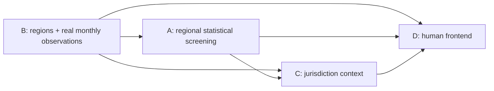

# EarthRisk team delivery plan

Controller review: 2026-11-14. Target: demo on November 15, followed by scientific review. This document supersedes older task orderings where they conflict. Existing individual methodology and provenance documents still apply.

## Goal and scope

Show a worldwide globe with geographically identified observations. Selecting a region should show dataset-derived quantitative results and automatically request a separately labeled AI research brief about relevant policies and articles. Human Member D owns the design and frontend code; automated frontend work is deferred at the user's request.

The initial regional unit is a 10° latitude/longitude cell: 648 cells covering the Earth. Freeze the demo analysis period at January 2003–December 2024. NDVI and `soil_water_0_100cm` are the primary pair. Surface soil water is available for sensitivity work. Soil water remains `kg m-2`; NDVI is dimensionless. Empty or unsupported cells remain visible in the catalog with explicit status. Never turn a whole-Earth mean into local measurements.

## Repository review and baseline

The repository already contains real NASA-derived global summaries, 318 monthly GLDAS source files, 26 MODIS aggregate export files including pilot and repair inputs, a central-US GLDAS sample, source manifests, preprocessing, statistics, research scaffolding, Streamlit UI, tests, and methodology documents. The latest policy-agent merge adds an evaluation harness. Existing code must be reused rather than rebuilt.

| Member | Existing work | Remaining gap |
| --- | --- | --- |
| A: statistics | Annual aggregation; OLS, Theil–Sen and Mann–Kendall; reliability, robustness and within-region multiple-test checks; JSON schema 0.3 | Batch regional screening, an explicitly defined worldwide testing family, and reproducible regional results |
| B: data | Real MODIS and GLDAS global means; source hashes and QA reports; public real-data reader; central-US sample | Regional MODIS observations, regional GLDAS processing, worldwide geographic catalog and jurisdiction context |
| C: research | Candidate discovery, human-reviewed evidence validation, explanation adapter, evaluation harness | Configured live retrieval/model adapters, automatic regional workflow, bounded requests and cache/failure states |
| D: frontend | Streamlit plots, provenance and downloads; real-data selectors; preliminary source-QA warnings | Human globe design and implementation, regional selection and automatic research integration |

The global required-period data contain all 264 months for each of three indicators. Extended data preserve missing endpoint months. Global MODIS and GLDAS use different valid footprints: their aggregate coverage fractions do not establish geographic overlap. Independent MODIS source-pixel validation remains pending. A statistical signal does not establish ecological damage, causality or policy failure.

## Controller and workers

The controller integrates contracts, reviews changes, runs the combined tests and tracks external work. Three workers cover A, B and C concurrently. D stays with the humans. Workers own separate files and do not commit, change shared interfaces without coordination, alter another member's files or access accounts on behalf of humans.

Routine coding and reproducible processing proceed automatically. The controller asks humans only for choices that affect scope, interpretation, credentials, account operations or presentation. Scientific approval is a human review task; a passing test does not confer it.

## Shared contracts and dependencies

- B catalog: `data/regions/grid_10deg.geojson`, stable `grid_r00_c00` IDs ordered south to north, west to east. Each feature contains geometry, bbox, centroid, availability and jurisdictions. Updated availability lives in `data/processed/regional/catalog.json`.
- B observations: `data/processed/regional/monthly_timeseries.csv`, required six-column contract plus valid area, coverage and quality flags. Missing data remain missing. Provenance and source hashes remain durable sidecars.
- A batch output: `data/processed/regional/screening.json`. Per-region geometry, status, original regional analysis and a separate worldwide-adjusted screening result. Source QA limitations remain visible.
- C input: A's analysis plus B's region ID, bbox, jurisdictions, period and dataset version. Output keeps quantitative analysis separate from qualitative text, sources, verification status and cache/error state.
- Existing `get_timeseries` and `analyze_region` callers remain compatible. The frontend should use the new regional artifacts and APIs through documented handoffs.

## Member A — statistical screening

1. Reuse the existing annual analysis with the primary indicator names explicitly configured. Require complete calendar years by default; preserve reported exclusions and missingness.
2. Analyze every catalog region with sufficient real paired observations. Return pending, unsupported or insufficient states honestly. Do not select regions merely because they produce attractive trends.
3. Define the worldwide multiple-testing family as the finite primary-indicator Mann–Kendall tests among eligible regions. Record its size and adjustment. Preserve existing within-region results separately.
4. Apply the existing direction, interval, reliability and robustness gates to worldwide screening. Explain that spatial dependence and source QA still require review.
5. Export deterministic JSON with period, input provenance and categories. Test missing indicators, insufficient years, unsupported regions, worldwide adjustment and JSON serialization.
6. Human A reviews the interpretation, test family, threshold assumptions and scientific wording. Later work includes autocorrelation/spatial dependence, sensitivity and independent numerical comparison.

Depends on B's contract; full real screening waits for regional MODIS exports. Synthetic fixtures may test code, with explicit synthetic labels.

## Member B — regional data and provenance

1. Generate the complete 648-cell catalog without overlap or gaps, with stable identifiers, EPSG:4326 boundaries and representative centroids. Account for polar and date-line boundaries.
2. Process existing monthly GLDAS files into regional surface and 0–100 cm storage using area weighting and valid layer masks. Keep units, missing values, source hashes and coverage. Do not impose a global 80% area threshold that rejects coastal cells merely because they contain ocean.
3. Add public-domain country intersections to support jurisdiction-aware research, documenting source, boundary version, disputed geography limitations and overlap method. Unknown context must remain unknown.
4. Prepare a regional MODIS Earth Engine exporter using the existing product, native projection, QA rules and one-time scaling. Run one pilot month first, then 22 yearly tasks for 2003–2024. If a yearly task exceeds limits, split by month with unchanged scientific settings.
5. Ingest exported regional CSVs with strict date, ID, unit, duplicate and coverage validation. Preserve missing months and make completeness explicit. Do not infer regional NDVI from the global average.
6. Compare sample regional means independently and reconcile regional area-weighted sums with global outputs using documented boundary tolerances. Check coverage variation and geographic support between indicators before scientific approval.
7. Package metadata, commands, quality reports and manifests. Human B launches authorized Earth Engine tasks, saves exports and reviews source/coverage decisions. Existing raw files remain preserved.

Regional export execution is the principal external dependency. Existing global downloads do not need to be repeated.

## Member C — regional policies and articles

1. Implement a server-side retrieval adapter and configured model endpoint with bounded request counts and timeouts. Credentials come from environment variables, never committed files or frontend payloads.
2. Use B's intersecting jurisdictions. Initially research up to three largest overlapping jurisdictions and disclose this limit. Unknown jurisdiction context returns a clear state rather than a worldwide policy claim.
3. Retrieve source text and distinguish government policy, scientific literature and news. Preserve titles, original URLs, retrieval time, jurisdiction, evidence type and unknown effective/legal status.
4. Generate qualitative findings linked to retrieved sources. Keep A's quantitative payload separate. Treat fetched content as untrusted input; reject malformed output and citations outside the retrieved source set. Machine-generated text remains unreviewed, separate from the existing human-reviewed workflow.
5. Cache by region, jurisdictions, period, dataset version and query version with a 24-hour fresh period. Matching cached results may support an outage; unrelated region reports must never substitute.
6. Test unavailable credentials, timeouts, malformed responses, prompt injection, invalid citations and cache isolation. No search results means no evidence found, not proof that no policy exists.
7. Human C supplies provider/model settings locally, confirms permitted spending and reviews a few region-specific reports. Later work includes broader multilingual coverage, legal-status checking and expert review.

Live research depends on B's jurisdiction context and human-managed service configuration. Offline failures and injected test providers must work without credentials.

## Member D — human design and frontend

Automated D implementation is deferred. The human team supplies designs and code, then the controller reviews integration against these acceptance requirements:

1. Render the worldwide catalog with selectable geography and distinct pending, unsupported, insufficient and computed states. The region list should remain usable if globe rendering fails.
2. On selection, show stored dataset observations, units, coverage, period, statistical categories and limitations immediately. A region's marker must refer to that region's observations.
3. Start C's research automatically for the selected region, show loading/cache/unavailable states and discard stale responses after selection changes.
4. Keep numerical analysis and AI narrative visibly distinct. Render original source links and verification labels, plus provenance/data/analysis exports.
5. Display every selected indicator; preserve gaps and distinguish the observation window from annual years used for fitting. Keep a separately labeled global overview and synthetic demonstration.
6. Configure deployment secrets on the server; rehearse source failures and a cached/offline presentation. Validate the actual browser interaction and mobile/keyboard access.

D can design against the shared contracts before regional exports finish. Final integration depends on B, A and C outputs.

## Delivery order and completion gates

| Phase | Automated work | Human dependency | Completion gate |
| --- | --- | --- | --- |
| Contracts | Grid/schema, regional statistics and research interfaces | Supply D designs when ready | All workers agree paths, IDs and status meanings |
| Data preparation | Regional GLDAS, export script, importer, provenance | Launch pilot, inspect it, launch yearly Earth Engine exports | Real regional soil data and reproducible MODIS request |
| Integration | Merge exports, batch screening, research pipeline, tests | Save MODIS exports; configure live services locally | Geographic IDs and periods align across B→A→C |
| Demo rehearsal | Completeness checks, failure/cached behavior, combined tests | D frontend and provider configuration | Honest map, dataset numbers, sourced research or explicit failure |
| Scientific review | Validation artifacts and sensitivity support | A/B/C review evidence and assumptions | Documented decisions before calling results validated |

If exports are delayed, show completed observations and clearly label partial coverage. Whole-Earth results remain an overview. A fully populated globe requires each eligible region to be computed or explicitly unavailable. No invented values or synthetic hotspots may appear as NASA-derived observations.

## Verification and remaining decisions

Run the combined suite with Python 3.12 and `requirements-data.txt`; CI must install those dependencies because existing tests import geospatial modules. Check source hashes, grid coverage, monthly uniqueness, real/synthetic separation, area weighting, missing data and cross-module status handling.

The team still needs to review: whether distinct MODIS/GLDAS footprints suffice for the demo and what common-footprint work follows; independent MODIS validation; the scientific multiple-testing interpretation; live-provider budget and credentials; and D's final design/deployment target. Preliminary results must carry these limitations until review is recorded.

The user explicitly requested this coordinated implementation on `main`; the controller fast-forwarded local `main` to the latest team merge and carried the changes there. This overrides the older branch instruction for this session. Human owners retain responsibility for scientific and presentation sign-off.

## Current execution and immediate human actions

A, B and C workers have delivered their backend implementations. B generated 158,928 real GLDAS rows for 301 supported cells over 264 months and two depths; all 648 catalog cells remain present. A generated a screening artifact with pending or unsupported states and zero paired tests because regional NDVI has not arrived. C has configured, connection-tested services and a genuine Canada research rehearsal artifact; its machine/source-review status must be read from the report. D's code remains untouched.

The controller connected the public regional reader and the B→A→C handoff in `src/regional_workflow.py`. `load_region` reads stored numbers and context; `research_selected_region` starts optional research. A stored screening is served only when its source CSV and catalog hashes match current inputs. After any regional import, rebuild screening with `python scripts/build_regional_screening.py`.

Next human work:

1. B: follow `docs/member_b_regional_steps.md` to launch and retrieve the regional MODIS pilot, then the annual exports.
2. C: DeepSeek and Tavily keys are now configured privately and connection checks passed. Follow `docs/member_c_regional_steps.md` for live research commands, cache behavior and source review. Account login details are unnecessary. Source and jurisdiction applicability still need review.
3. D: send the human designs/code when ready; use the documented backend contracts without rebuilding statistics or observations in browser code.
4. A/B/C: review scientific interpretation, footprint limitations and source claims before promoting preliminary results to reviewed findings.

### Follow-up execution

The A worker added available-indicator soil-water diagnostics for supported cells while preserving pending paired screening and a worldwide paired family of zero tests. It also fixed pending NDVI placeholders being mistaken for received but insufficient observations. The controller regenerated all 648 screening records and connected diagnostics to the research quantitative payload. None of this establishes a greening/drying hotspot without regional NDVI.

The controller bound cache identity to actual observation and catalog bytes as well as provenance, and tested that changing observations or boundaries withholds stale statistical artifacts. B completed read-only pilot validation and protections against losing accepted imports, with roundtrip tests and separate exported/valid-month counts. C retrieved real Canada sources and tested the bounded model workflow, preserving unreviewed labels and rejecting invalid drafts. This is a backend rehearsal; D's frontend remains untouched.

## Milestone review rule

At the user's request, finish each major milestone with appropriate checks, a commit and push to `main`, then stop for human team review. Do not start the next milestone until the user continues the work. Keep credentials and unrelated local editor settings out of commits.

### Backend milestone verification

The combined Python 3.12 suite passed 134 tests and 68 subtests. The current artifact has 648 regions: 301 pending paired analysis with real soil-water diagnostics, and 347 unsupported by GLDAS. C's Canada sample completed with four real citations and machine-generated/unreviewed status; two searches and two model attempts were used, with the first rejected partial report retained separately. No frontend code changed. Regional MODIS acquisition and human source/scientific review remain outstanding.

### Backend handoff and frontend review milestone

- A added compact `map_screening.geojson`, copied numerical summaries, explicit testing-family completeness and tests of the eight-year eligibility boundary. No standalone soil trend is promoted to a paired hotspot.
- B added incremental imports with retained, hash-addressed source archives and an accepted-observation ledger. Identical rows are idempotent; conflicting observations or provenance require explicit replacement. The release audit verifies source hashes, completeness, physical units, catalog consistency and regional/global reconciliation.
- C added validated offline reuse of the genuine Canada brief and bounded background research jobs with duplicate suppression, cancellation/deadline handling and region/context identity checks. No new paid research calls were made for this milestone.
- The controller added one-command backend preparation, JSON region-detail exports for all 648 cells, isolated reusable data snapshots and stale-result checks. Details are reproducible under `.cache/regional_handoff/`; the compact geographic artifact and release audit are retained with the processed data.
- The human frontend merged at `203e7a4` was fast-forwarded locally and reviewed without design changes. Its locked-dependency build and a headless Chrome synthetic-region check passed. It still needs the integration changes in `docs/frontend_backend_review.md` before displaying real regional data and A's authoritative classifications.
- CI now includes a frontend build. Standard Python discovery is scoped to the portable `tests/` suite; the frontend's machine-specific browser harness is separate.
- Google OAuth and read-only Earth Engine initialization succeeded for project `earthrisk-greenmirage`; credentials remain outside Git. A regional pilot task was submitted and failed with a geometry-bounds error, isolated to raster reduction at polar boundaries. The exporter fix and cloud verification status are recorded in B's handoff; no annual batch should run before a pilot passes structural/provenance checks.

Verification for this milestone: 161 Python tests and 68 subtests passed; the frontend locked-dependency production build passed; a headless Chrome synthetic-globe/panel/audit check had zero page errors. The release audit passed 5,573 checks and still reports zero paired-preview eligible regions because no regional NDVI has been imported.

An explicitly partial nonpolar pilot completed as task `ELF7RDWO3DRQGYIJY2PJWY6Q`. Its CSV was downloaded through the authorized Google Drive API, checksum-verified, and passed the strict read-only structural/provenance audit. It contains 576 unchanged nonpolar cells for January 2003: 249 finite NDVI means, of which 205 overlap GLDAS-supported cells. The requested nonpolar scope includes 285 GLDAS-supported cells; not every requested cell has a valid QA-passing value in that winter month. All 648 local catalog cells remain present, and 16 supported northern polar cells retain pending NDVI. This is a temporary data-acquisition scope, not a resolution change, clipped region or claim that polar data are unsupported.

The raw pilot is retained in `data/raw/modis_earth_engine/regional_validation/`, with `data/processed/regional/modis_pilot_audit.json`. Its audit correctly reports incomplete full-grid coverage (72 polar cells outside this export). The pilot has not been imported into the accepted monthly release; one month cannot establish a trend. Independent pixel validation remains pending. No annual tasks have been launched: stop after this milestone commit/push for human review. After continuation, the existing authenticated Python exporter can submit annual nonpolar tasks; the full polar export defect remains unresolved.

The release remains scientifically provisional, and regional NDVI is not yet available. Passing backend integrity checks is separate from complete observations or a fully integrated frontend. After the milestone commit/push, stop for team review as requested.

### Real-data globe integration — 2026-11-15

Continuation authorized the next milestone. The controller submitted all 22 annual
nonpolar MODIS tasks for 2003–2024 using the unchanged validated pilot method.
Task IDs and a timestamped status snapshot are retained in
`data/requests/earth_engine_annual_tasks.json`; cloud completion is asynchronous.
B added Drive synchronization with immutable downloads and explicit validated
incremental ingestion, so manual downloads are no longer required.

C supplied a local HTTP API that serves the map catalog, region observations,
authoritative statistics, cached research and bounded live jobs. Private settings
remain server-side; live requests require the server's `--enable-live` flag.
A supplied annual fitted coordinates from stored coefficients and fixed audit
formatting, canonical soil-depth names, UTC dates and null gaps. A partial NDVI
import retains the long standalone soil record while paired screening remains
insufficient; it never fabricates paired years or promotes standalone p-values.

The controller connected the existing human-designed React globe to these APIs:
real grid markers/menu, geographic-cell selection, observations and provenance,
backend statistical categories, and selection-triggered research with stale-response
suppression. The visual design remains based on the team's frontend. Current cyan
markers represent data availability, not detected environmental risk. Amber or
purple marker classifications can only come from stored paired screening.

Browser verification selected a real Canadian cell, displayed its 264 monthly
0–100 cm observations, 22-year annual statistics in `kg m-2`, explicit pending
paired screening, source QA limitations, and the genuine four-source cached brief.
This verification made no paid provider requests. Source-pixel/footprint review
and regional NDVI history remain pending. The milestone ends with commit/push and
human review; queued Earth Engine tasks continue independently in the cloud.

Final milestone verification: 178 Python tests and 68 subtests passed, the frontend
production build passed, and headless Chrome verified actual backend slope values,
264 finite monthly observations, 22 annual values, geographic boundary mapping,
pending classification and the genuine cached report with no page errors. The
local API was then started with live research enabled for interactive use; browser
verification reused the Canada cache and made no new paid research calls. At the
last cloud check, three annual tasks were running, 19 were queued, and no annual
CSV had completed. This is a working real-soil-data demo; paired hotspots await
sufficient NDVI history and remain scientifically provisional.
